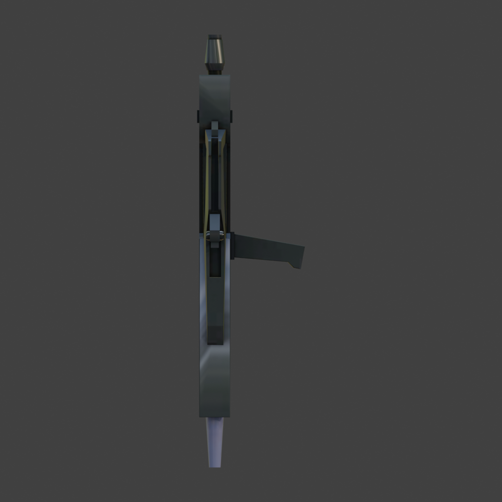
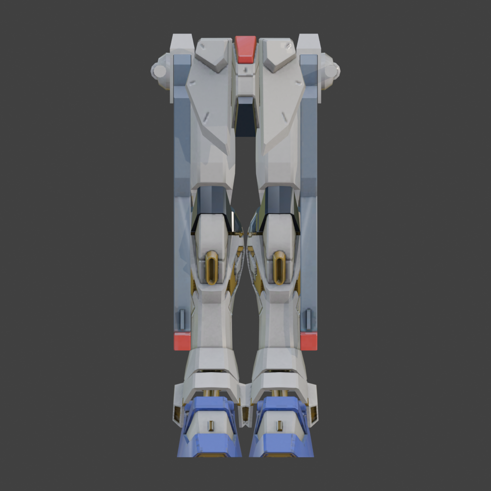
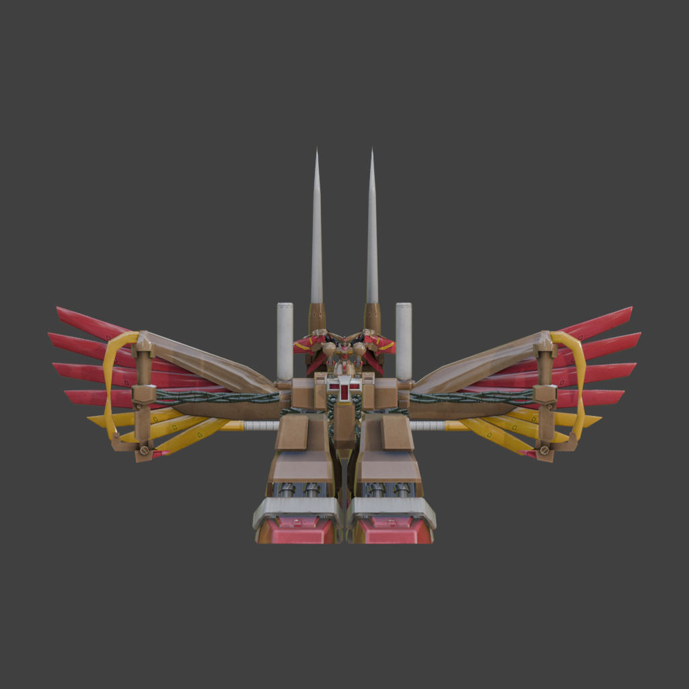
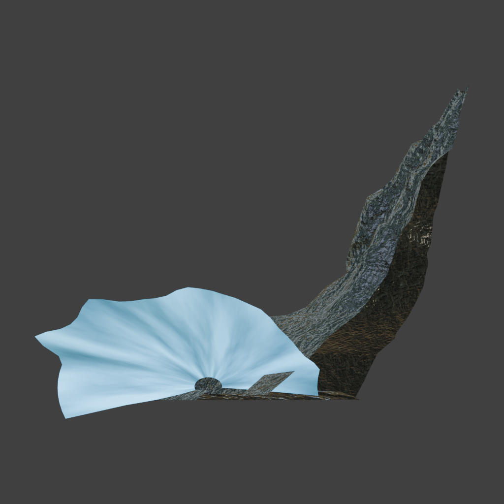
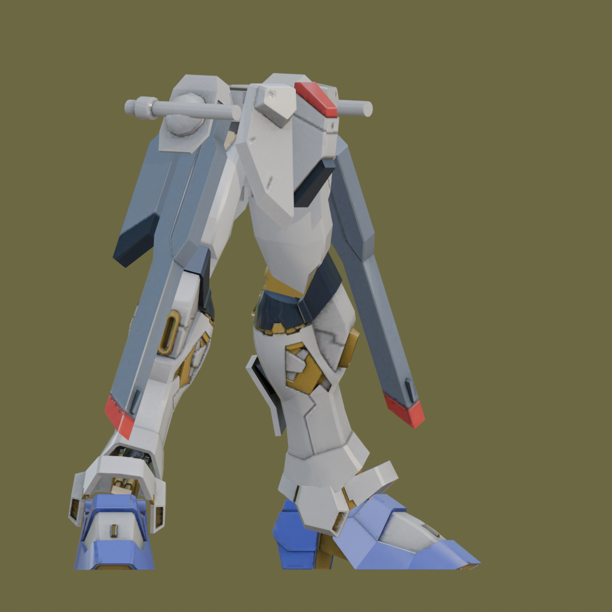

# Gundam Breaker Importer for Blender 5.2

Blender 5.2 extension for importing models, skeletons, materials, textures,
and skeletal animations from:

- **Gundam Breaker** (PS3), directly from an ISO, an extracted game folder, or
  a `GxArchivedFile*.dat` archive.
- **Gundam Breaker 3** (Vita), from decrypted game files.

The importer reads the game archives in place. It does not extract an ISO or
write game assets to disk.

## Features

- Native ISO9660 reader with segmented multi-extent file support.
- Big-endian PS3 and little-endian Vita Orochi `GDAT`, `PAC`, and `BILZ`
  support.
- Separate PS3 and Vita MDL, MDC, FVF, vertex, index, and texture paths.
- NumPy-accelerated vertex and texture decoding.
- Blender bulk mesh creation through `foreach_set`.
- Armatures, parented bones, vertex groups, and Armature modifiers.
- Native PS3 MPK motion packages, compatible-package discovery, and clip
  selection.
- Blender 5.2 layered/slotted Actions baked at the source 30 FPS with
  quaternion continuity, absolute-reference rotation conversion, and
  two-bone endpoint IK.
- UVs, vertex colors, custom split normals, material slots, and LOD/submesh
  face attributes.
- Principled BSDF materials with color, normal, and specular texture wiring.
- Direct image pixel upload and packing into the blend file.
- BC1, BC2, BC3, raw BGRA/A8, BC7 DDS fallback, PS3 padded BC rows, and PS3
  BC1 cubemap atlases.
- Searchable model browser with multi-selection.

## Import examples

These front orthographic screenshots use Blender's Material Preview shading
with textures packed directly by the importer.

| Compact rig (`chr5490`) | Typical rig (`chr4175`) |
| --- | --- |
|  |  |

| Complex 164-bone rig (`chr4670`) | Static multipart asset (`2A835EA9`) |
| --- | --- |
|  |  |

### Animation support

Native PS3 MPK clips are baked into Blender Actions with reference-rotation
conversion and two-bone endpoint IK so articulated rigid parts remain
connected throughout the animation.



## Install

1. Build or download `gundam_breaker_importer-0.2.0.zip`.
2. In Blender 5.2, open **Edit > Preferences > Get Extensions**.
3. Use **Install from Disk** and choose the ZIP.
4. Enable **Gundam Breaker Importer** if Blender does not enable it
   automatically.

The importer is available in:

- **File > Import > Gundam Breaker Game Source**
- **3D View > Sidebar > Gundam Breaker**

## Use

1. Choose the game profile or leave it on **Auto Detect**.
2. Select a source:
   - Original PS3 game: `.iso`, extracted game folder, or DAT archive.
   - Gundam Breaker 3 Vita: decrypted game folder or DAT archive.
3. Click **Scan**.
4. Search the model list and check one or more models.
5. Choose whether to import and pack textures.
6. Click **Import Selected Models**.

If no model is checked, the active row is imported.

### Import animations

PS3 animations can be added after importing a rig:

1. Select the imported armature or its mesh.
2. Click **Find Compatible Animations**.
3. Check one or more direct or `gmp` motion packages.
4. Choose **Single**, **Range**, or **All** clips. Clip numbers are one-based.
5. Click **Import Selected Animations**.

The importer creates persistent Blender Actions, assigns the first new Action
to the rig, sets playback to 30 FPS, and updates the scene frame range. The
default **Single** mode avoids accidentally creating hundreds of Actions from
large character packages. The Action selector in Blender's Dope Sheet or
Animation workspace can be used to switch clips afterward. MPK reference
orientations and endpoint-target IK are resolved during baking so articulated
rigid parts remain connected in the resulting Action.

The original PS3 MPK path is currently supported. Gundam Breaker 3 Vita uses
a different motion resource type and remains a separate future import path.

### Encrypted Vita dumps

NoNpDrm installations retain a PFS encryption layer. If the chosen Vita DAT
does not begin with `GDAT`, decrypt the game files with a lawful local tool
such as Vita3K or Nativ first. The extension never asks for or stores game
keys.

## Output

Each imported asset receives its own collection:

- One combined mesh object with material assignments.
- An armature and Armature modifier when the source model is rigged.
- Blender Actions for selected compatible PS3 MPK clips.
- Packed Blender images for decoded textures.
- `gundam_submesh` and `gundam_lod` integer face attributes.
- Source profile and resource hash custom properties.

PS3 cubemaps are preserved as a 3 x 2 face atlas. They are retained as
material texture nodes but are not connected to the Principled shader's
surface inputs.

## Development and validation

Run the parser tests (including synthetic MPK curves and sparse SRT binding):

```powershell
python -m unittest discover -s tests -p "test_*.py" -v
```

Run the Blender 5.2 API smoke test:

```powershell
& "D:\Blender Foundation\Blender 5.2\blender.exe" `
  --background --factory-startup --python tests\blender_smoke.py
```

Build the extension:

```powershell
& "D:\Blender Foundation\Blender 5.2\blender.exe" `
  --command extension build `
  --source-dir gundam_breaker_importer `
  --output-dir dist
```

No game assets, decrypted payloads, or keys belong in this project or its
extension package.

## Format notes and attribution

- Reverse-engineered format notes are in
  [`docs/FORMAT_NOTES.md`](docs/FORMAT_NOTES.md).
- Third-party research attribution is in
  [`gundam_breaker_importer/THIRD_PARTY_NOTICES.md`](gundam_breaker_importer/THIRD_PARTY_NOTICES.md).

The extension is licensed under GPL-3.0-or-later.
